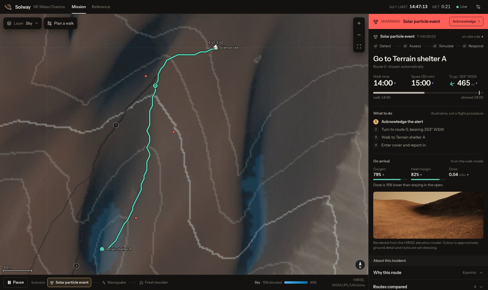
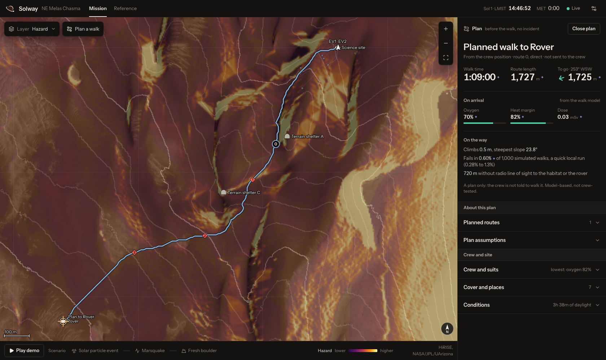
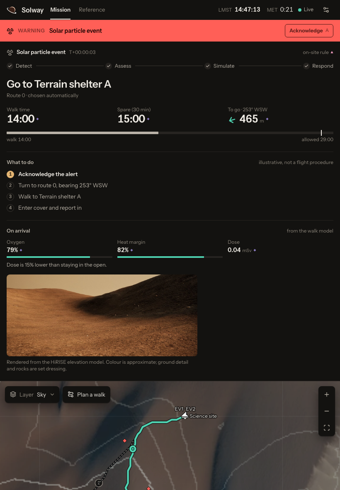

# Solway

Solway is an incident-response aid for crews on foot on the Martian surface. It is meant for a crew member or a
planner who has to decide, with little time and no help from Earth, where to walk when something goes wrong during an
extravehicular walk. A message to Earth and back takes about 22 minutes in November 2026 (from JPL Horizons
distances) and up to about 44 minutes at the longest. The demo is set in north-east Melas Chasma (about 10.0°S, 290.04°E)
on real HiRISE and CTX terrain.

NASA's 2026 Civil Space Shortfalls list this as an open need (8.06): "Provide in-situ decision support tools to address
identified EVA hazards and risks on the Martian surface"
([list](https://www.nasa.gov/wp-content/uploads/2026/03/2026-civil-space-shortfalls.pdf)).

It was made for the NASA Space Apps Challenge 2026, challenge "Interplanetary Survival Guide: Martian Map".
It is not affiliated with or endorsed by NASA, and it is a planning aid only. Nothing here has been tested with a crew.

**Recorded demo in the browser, no install: [solway-demo.vercel.app](https://solway-demo.vercel.app)**



The dashboard during the solar particle event scenario. One map and one panel. A new incident is announced as a
warning that stays until someone acknowledges it. The panel then leads with the decision: where to go, the walking time
against the 30-minute shelter rule, the distance and bearing, what is left on arrival, and the steps in order. The
detail behind it (why this route, the routes compared, crew and suits, detection and hazard, cover and places,
conditions) opens in place, one group at a time. Every figure is labelled as measured, model, requirement, assumption
or scenario.

Nothing runs when the dashboard opens: it stands by with the crew, the nearest cover and the values it watches (dose
rate against the alert threshold, ground motion, daylight left, the round trip of a question to Earth). The map is
interactive: a click on a place gives its distance and bearing from the crew and can ask for a route to it, a click on
a route line opens that route, and the bar under the map plays, pauses and scrubs the recorded run or reopens an
earlier incident. A selected place and the chosen destination show a view rendered from the HiRISE elevation model.
The display is dark and uses the colour meanings of NASA-STD-3001 Volume 2
(red warning, yellow caution, blue advisory, cyan for stale data), always with a word or a shape beside the colour.
Keys: Space plays or pauses, A acknowledges, P plans a walk, Esc closes.



Plan a walk, before going out: a click on the map returns the route from the crew to that point, with its walking time,
what is left on arrival, the failure rate from a small local Monte Carlo run, and the metres without radio line of
sight. No incident is involved and the crew is not sent anywhere.



On a tablet or a cuff display the same screen is one column with large targets: the decision first, then the map, then
the detail groups (above). A recorded run of the demo plays in a browser with no engine (`npm run build:web`, see below).


The 3D view: the crew walks the chosen route on the HiRISE terrain, with the rover and the habitat marked ahead.
The terrain colour is approximate, and the dust is set dressing.

## How it works

An incident goes through four phases.

1. **Detect.** The solar storm is raised by an on-site rule: the alert fires when the dose rate at the crew is 25%
   above the background, the threshold of the published RAD nowcast (Löwe et al. 2025), applied to the engine's modelled
   dose rate. The storm itself is a scenario replay of the 20 May 2024 event. Next to the alert the dashboard shows what
   Earth-side monitoring recorded for that storm (the saved NASA CCMC DONKI record): the first notification came 10.3 h
   after the eruption was first seen and Mars was not among the predicted impacts. That record is context; it never
   triggers anything. The other incidents fire on the mission clock or after the crew has walked for a set time. Every
   incident appears with its source and a flag that says it is a scenario, not an observation.
2. **Assess.** The engine updates the hazard layers over the 4 × 4 km core box (800 × 800 cells of 5 m): combined hazard,
   slope, rockfall runout band, loose-sand likelihood, blocked sky, dose rate in the open, and where virtual crews failed.
   Shelters that fall inside an active rockfall band are closed. The dashboard map adds elevation contours and a radio
   layer: the ground with no direct line of sight to the habitat or rover antenna, and for each route how many metres
   of it are out of sight.
3. **Simulate.** A grid planner (goal-rooted Dijkstra on the 5 m grid) proposes candidate routes from the crew to each
   open shelter. Each route is then stress-tested with a walk model of one suited walker (pace, stored heat, oxygen,
   falls, dose). The result is a failure rate from Monte Carlo runs with its confidence interval. When results of an
   Adaptive Stress Testing run (Lee et al., 2020) are present in `data/ast/`, the engine also reports a robustness
   figure in nats and the most likely failures. In that method a reinforcement-learning adversary searches the
   disturbances (weaker suit cooling, stumbles, navigation drift) for the most likely way a route fails. The adversary
   tests routes. It does not choose them, and the virtual crews follow the planner's polyline.
4. **Respond.** The engine marks one route as chosen, or the operator picks one. Among the routes that meet the
   incident's rule it prefers the highest robustness when that exists, otherwise the lowest failure rate. If none meets
   the rule it falls back to the fastest route or the lowest failure rate (`Director._choose`). The dashboard
   shows the walking time against the time the rule allows, the heading and distance to go, oxygen, heat and dose on
   arrival, and the hazards avoided. Every number carries a kind (`measured`, `model`, `requirement`, `assumption`,
   `scenario`) and a source.

Beside the response the dashboard keeps what a crew on foot checks during a walk: daylight left (computed from the Sun
position at the site), the one-way light time to Earth, each crew member's oxygen, heat margin and dose, shelters open
or closed, and a measured weather reference for the season (Curiosity REMS at Gale crater, labelled as an analogue).

The demo plays three linked scenario incidents (`data/scenario/`):

| Id | Incident | What happens |
|---|---|---|
| `sep-1` | Solar particle event | Timing follows the 20 May 2024 event seen by the MSL RAD instrument. The on-site dose-rate rule raises the alert a few seconds after the storm reaches the site. The crew walks to a shelter under a 30-minute rule. |
| `quake-1` | Marsquake | The rockfall runout band below the wall becomes active, shelters inside it close, routes are planned again from where the crew is. |
| `sci-1` | Fresh boulder | One sol later, no storm. A walk from the rover to a fresh boulder and back, with the runout band as a hazard. A boulder that came down the wall brings rock from layers nobody can walk to, the reason Apollo 17 sampled the boulders at Station 6. |

## Architecture

Three processes on one machine. The Python engine is the authority: it owns the mission clock, the scenario, the hazard
layers, the routes and the stress-test results. The two windows display what the engine sends.

```
                    WebSocket + HTTP, 127.0.0.1:8765
  dashboard  <------------------------------------------>  engine (Python)
  (Electron + React)        commands go back on the socket      |   |
                                                                |   |  files in runtime/
                                       OSC over UDP, 127.0.0.1:9000 |  (routes.json, trajectories.json,
                                                                |   |   overlay_<layer>.png)
                                                                v   v
                                                  simulation window (Unreal Engine 5.8)

  data/site, data/scenario, data/ast  --->  engine   (precomputed inputs, read at start)
```

| Part | What it does | Technology | Port |
|---|---|---|---|
| Engine | Clock, scenario, hazards, route planning, stress tests; serves the dashboard and sends OSC | Python 3.12, numpy, numba, FastAPI, uvicorn, python-osc | 8765 (HTTP and WebSocket `/ws`), sends to UDP 9000 |
| Dashboard | The product: one map and one response panel, wide, laptop and single-column field layouts, with method, parameters, decision log and sources pages | Electron, Vite, React 19, Tailwind 4, Recharts | dev server 5173 |
| Simulation | Real terrain in 3D, crew, hazard overlays, routes, marsquake effects, cameras | Unreal Engine 5.8, project `unreal/MelasSim` | listens on UDP 9000 |
| Adversary training (optional) | Trains the stress-test adversary offline on another machine and writes `data/ast/` | Python, PyTorch | none |

Port 8000 belongs to the Unreal editor's MCP server (off unless the editor is started with `-ModelContextProtocolStartServer`).
The engine never uses it. The dashboard does not start the Unreal window; start it yourself (`unreal/README.md`).
Messages, OSC addresses, coordinates and file formats are defined in `docs/CONTRACT.md`.
The demo plays from saved files. Nothing is fetched from the network at run time.

## Run it

Requirements: Python 3.12 with [uv](https://docs.astral.sh/uv/), Node.js with npm for the dashboard, and Unreal Engine 5.8
for the 3D window. `uv` creates the environment on first run.

### Engine

```
uv run python -m engine
```

Serves on `127.0.0.1:8765` and sends OSC to `127.0.0.1:9000`. The first start compiles the numba kernels, later starts are faster.

| Flag | Effect |
|---|---|
| `--no-osc` | Do not send OSC |
| `--demo` | Start the three-incident demo immediately |
| `--check` | Play the whole scenario without sockets, print a summary, exit 1 on inconsistency |
| `--port PORT` | HTTP and WebSocket port (default 8765) |
| `--walkers N` | Monte Carlo walkers per route (default from the engine parameters) |

The OSC target is fixed at `127.0.0.1:9000` in `engine/osc.py`. Tests: `uv run pytest`.

### Dashboard

```
cd dashboard
npm install
npm run dev
```

`npm run dev` starts Vite and Electron for development and does not start the engine, so run the engine in another terminal.
To run the built app, use `npm run build` and then `npm start`; Electron then starts the engine itself with
`uv run python -m engine` from the repository root.

| Script | Effect |
|---|---|
| `dev` | Vite and Electron, development |
| `dev:web` | Vite only, open `http://127.0.0.1:5173` in a browser |
| `mock` | Mock engine on port 8766 for working on the dashboard without the real engine |
| `typecheck` | TypeScript check |
| `build` | Type check and production build into `dist/` |
| `build:web` | Static build into `dist-web/` that plays the recorded run in `public/replay/`; needs no engine |
| `preview` | Preview the production build |
| `start` | Electron on the built files (starts the engine) |
| `dist` | Build and package with electron-builder (unpacked directory per platform) |
| `shots` | Screenshots of the dashboard against the mock engine |

Environment variables: `VITE_ENGINE_URL` (default `ws://127.0.0.1:8765/ws`), `SOLWAY_ROOT` (repository root for the engine),
`SOLWAY_ENGINE=external` (do not start an engine from Electron).
The top bar has two destinations: Mission (the display above) and Reference (Method and limits, Parameters, Sources,
Event log with JSON export). **Play demo** under the map plays the three incidents; nothing starts by itself. The
settings menu holds the alert sound and the exercise controls (reset, clock speed, single
incidents).

**Plan a walk**, in the same menu, is for before a walk: a click on the map returns the walking route from the crew to
that point (Shift and click sets another start). It uses the same planner, hazard layers and walk model as the incident
routes, and its stress test is the engine's small Monte Carlo run, labelled "local preview". It involves no incident and
the crew is not sent anywhere. It needs the live engine, so it is off in the recorded run. The command and its answer are
in `docs/CONTRACT.md`, section 8.

**Without an engine.** `npm run build:web` makes a static site in `dist-web/` that plays a recorded run of the demo:
the engine's own messages and files, saved by `python tools/record_demo.py` into `dashboard/public/replay/`. Any static
host can serve it. Adding `?replay` to the address does the same in the development server. The header then says
"Recorded run", and choosing another route is off because that needs a live engine. Record again after the scenario,
the parameters or `data/ast/` change.

### Simulation window

See `unreal/README.md`. In short: open `unreal/MelasSim/MelasSim.uproject` in Unreal Engine 5.8, run the director script in the
editor, press Play, then start the demo from the dashboard.

### Stress-test training (optional)

The adversary is trained on a separate machine; the task is in `rl/TASK.md`. If `data/ast/ast_results.json` exists, the
engine serves its numbers with source `data/ast`. Otherwise the engine runs a small local Monte Carlo and labels it
"local preview".

This checkout carries the results of that run (`data/ast/`, summary in `data/ast/REPORT.md`): 200,000 Monte Carlo walks
per route for the solar particle event and the marsquake and 100,000 for the science walk, a cross-entropy search with
restarts, and a PPO adversary, three seeds each. What it found:

| Incident | Route | Monte Carlo failure rate | Robustness (nats) | Most likely failure found |
|---|---|---|---|---|
| Solar particle event | Terrain shelter A | 0.59 % | 7.8 | Incapacitating fall on a 21° slope |
| Solar particle event | Terrain shelter C | 1.23 % | 4.8 | Late: navigation off by 143 m |
| Solar particle event | Rover, Habitat | 100 % | not scored | Too far to reach in time even with no disturbance |
| Marsquake | Rover | 34.5 % | 0.7 | Late: navigation off by 24 m |
| Science walk | Both variants | 0.52 % and 0.54 % | 9.3 | Incapacitating fall on a 24° slope |

The PPO adversary did not beat the cross-entropy search in any of 21 seed-by-seed comparisons, so the cross-entropy
search is the reported method and PPO is listed as it is. The two science-walk variants are not separated by the test. The
batched simulator used for the search and the engine's own walker disagree on how often a walker is late (34.5 % against
19.7 % on the marsquake route); the table is in the report. All of it is model output from one walk model with
disturbance distributions that are team assumptions.

## Repository map

| Path | What |
|---|---|
| `engine/` | The Python engine: clock, scenario, hazards, routes, walk model, stress tests, WebSocket server, OSC |
| `dashboard/` | Electron and React dashboard, mock engine, screenshot scripts |
| `unreal/` | Unreal project `MelasSim` and the editor scripts that build and drive the scene |
| `rl/` | Route planner and walk environment used by the engine, the training task for the adversary (`TASK.md`, `SPEC.md`), earlier walking-policy trainer |
| `tools/` | Scripts that turn `data/site/` into files for Unreal (heightmaps, meshes, scene layout, dust texture), `record_demo.py` (recorded run for the dashboard), `make_weather_analogue.py` (season weather reference), `fetch_donki.py` (saves the DONKI record of the 20 May 2024 storm) |
| `pipeline/` | `10_build_site.py`: builds the terrain and hazard grids in `data/site/` from the NASA and USGS rasters |
| `data/site/` | Processed terrain, orthoimages and hazard layers, with `meta.json`; `weather_analogue.json` |
| `data/scenario/` | Scripted incidents and mission (`mission.json`, `sep-1.json`, `quake-1.json`, `sci-1.json`) |
| `data/space_weather/` | Saved NASA CCMC DONKI record of the 20 May 2024 solar event (`donki_2024-05-20.json`) |
| `data/ast/` | Stress-test results from the offline run, with `REPORT.md` |
| `data/exploration_zones_2015.txt` | Text of the first announcement of the 2015 landing-site and exploration-zone workshop, kept as background |
| `runtime/` | Files the engine writes while running (routes, trajectories, overlays, parameters) |
| `unreal_import/` | Generated inputs for Unreal (heightmaps, drape textures, meshes, scene layout) |
| `docs/` | `CONTRACT.md` (interfaces) and `research/` (design notes, partly in Romanian) |
| `reference/` | Earlier TypeScript engine and first walking policy, kept as reference for the Python ports |
| `tests/` | Engine tests |
| `assets_src/` | Raw 3D models and textures with a `SOURCE.txt` each (not in git) |
| `ASSETS.md`, `LICENSE` | Credits and licences, Apache 2.0 |

`pipeline/10_build_site.py` needs the extras `uv sync --extra pipeline` and raw files in `data_raw/` (not in git). It reads the
CTX DTM over the network. As written it writes to `app/public/data/site/`; copy the result into `data/site/`.
The `rl/` modules still mention the old `app/` paths in their docstrings. The engine reads `data/site/`.

## Data sources

All terrain comes from NASA Mars Reconnaissance Orbiter data distributed by USGS Astrogeology
(see `data/site/meta.json` and `ASSETS.md` for credit lines and licences).

| Dataset | Exact name | Used for |
|---|---|---|
| HiRISE DTM, 1 m | `DTEEC_028857_1700_028923_1700_A01` (USGS STAC collection `mro_hirise_socet_dtms`) | Core box elevation. Slope, roughness, rockfall reach angle, blocked sky, pits and the walk model are derived from it. |
| HiRISE orthoimage, 1 m, RED | `ESP_028857_1700_RED_C_01_ORTHO` | Greyscale base image of the map and the 3D terrain. |
| CTX DTM | `D04_028857_1684_XN_11S069W` and `D04_028923_1684_XN_11S069W` (USGS STAC collection `mro_ctx_controlled_usgs_dtms`) | Regional strip (16 m cells) and far backdrop (80 m cells); also fills the region orthoimage where HiRISE has no data. |
| JPL Horizons | Sun azimuth and elevation at the site, 06:00 to 12:00 UT on 15 Nov 2026; Earth to Mars distance for 15 and 16 Nov 2026 | Sun direction in the 3D scene, daylight left, and the Earth to Mars light time. Outside that window the engine uses the Mars24 algorithm (Allison and McEwen, 2000). |
| MSL REMS | Curiosity REMS daily weather reports, the 71 sols at solar longitude 20 to 24 degrees (sols 391 to 4412) | Ground and air temperature range and UV index for the season. Measured at Gale crater (4.6°S), shown as an analogue, not as the demo site. |
| MSL RAD, event of 20 May 2024 | Löwe et al. 2025, arXiv:2502.02469, Table 1 | Solar particle event: 53 min to peak, 57 min nowcast lead time, 1730.55 µGy recorded. The unshielded dose of 8100 µGy for an astronaut is credited to NASA/JPL (10 Jun 2024) in `sep-1.json`. |
| MSL RAD background | Hassler et al. 2014, Science 343 | Background dose rate. |
| NASA CCMC DONKI (Space Weather Database Of Notifications, Knowledge, Information) | Coronal mass ejection `2024-05-20T05:36:00-CME-001` with its analyses and WSA-ENLIL runs, the notifications sent for it, and the solar energetic particle records of 19 to 25 May 2024 | Earth-side record of the storm the scenario replays, shown next to the alert: when the eruption was first seen, when the first notification was issued, which targets the model runs predicted. Context only; the alert comes from the on-site rule. |
| InSight Mars Seismic Catalogue | MQS V14, doi 10.12686/a21 | The scenario marsquake is described as comparable to event S0976a. The quake itself is scripted. |
| Rockfall papers | Grindrod et al. 2021 (reach angle 27.8°); Vijayan et al. 2026 (rockfall after a marsquake at Cerberus Fossae) | Rockfall runout band and the post-quake rockfall rate. |
| NASA technical reports | NTRS 20210000827 (exploration EVA testing and analogs), NTRS 20220004017 (HRP evidence report on EVA), NTRS 19730008098 (Apollo 16 time and motion study), NTRS 20160001058 (suit cooling without sweep gas) | Planning speed, slope limit, heat and oxygen limits, the suit cooling floor used in the disturbances. Each value and its source is listed in `engine/params.py` and on the Parameters page. |
| Adaptive Stress Testing | Lee et al. 2020, Journal of Artificial Intelligence Research 69 | The stress-test method. |

Surface colour is not from a dataset: the orthoimage is greyscale and the colour is an approximate tint added in `pipeline/10_build_site.py`.

Kinds of data combined: topographic (HiRISE and CTX elevation), optical (HiRISE orthoimage), radiation (MSL RAD),
atmospheric (MSL REMS), seismic (InSight catalogue) and ephemeris (JPL Horizons).

## Modelled and real

Real data: elevation from the HiRISE and CTX DTMs, the greyscale orthoimage, Sun position and light time from Horizons,
the REMS weather reports (from Gale crater, not from the demo site), and the published figures listed above.

Derived from real data by our own models, not measured: slope, roughness, the rockfall runout band
(an energy-line cone from every source cell steeper than 32°, reach angle 27.8°), blocked sky and dose shielding, closed
depressions, elevation contours, radio line of sight (straight rays between assumed antenna heights, no diffraction),
and the loose-sand layer, which is a proxy from image brightness and smoothness.

Modelled: the walking and consumables model (speed, soil slowdown, metabolic rate, stored heat against the suit cooling
limit, oxygen use, falls, dose), the disturbances applied in the stress test, and all margins and failure rates. Each
parameter is in `engine/params.py` with its kind and source.

Scripted: the incidents and their timing, the crew, the places (science site, habitat, rover, shelters, boulder). The
solar profile is idealised (linear rise, exponential decay). The Melas marsquake is a scenario.

Set dressing in the 3D window, not simulation output: dust, the dust devil and the scout helicopter, the seismic station,
the Earth rock scans and ground textures, and the positions of boulders in the rockfall band (seeded and illustrative).

## Limitations

- One site and three scripted incidents. Planning for another place needs new terrain data and a new scenario.
- The detection rule runs on the engine's modelled dose rate, not on a dosimeter. It is a simplified form of the published RAD nowcast (one threshold on the dose rate) and the storm profile is idealised, so the few seconds between storm onset and alert are a model figure.
- Results are model-based. Fall rate, fall injury chance, suit mass, the sand penalty and the disturbance bounds are team assumptions.
- The stress test is only as good as the walk model. Robustness is an upper bound from a finite search: a more likely failure that no search found may exist. If `data/ast/` is removed, failure rates come from a small local Monte Carlo and there is no robustness figure.
- High-resolution elevation covers the 4 × 4 km core box. Beyond it the terrain is CTX with coarser cells. `data/site/meta.json` records a CTX offset of 10.9 m and a residual RMS of 38.6 m against the HiRISE DTM.
- The slope limit is a requirement borrowed from lunar suits, not established for Mars. The sand layer is an image proxy.
- The marsquake is a scenario at Melas Chasma. The rockfall response it uses was observed at Cerberus Fossae.
- Surface colour is approximate. Ground detail and rocks in 3D are Earth scans.
- The 3D window runs inside the Unreal editor with a Python director script. No packaged build is included.
- It has not been checked for operational use and does not replace a crew's judgement or mission control.

## Licence and credits

Code: Apache License 2.0, see `LICENSE`. Credits for terrain data, 3D models, textures, fonts and libraries, with authors,
sources and licences: `ASSETS.md`. No NASA logos or insignia are used.
